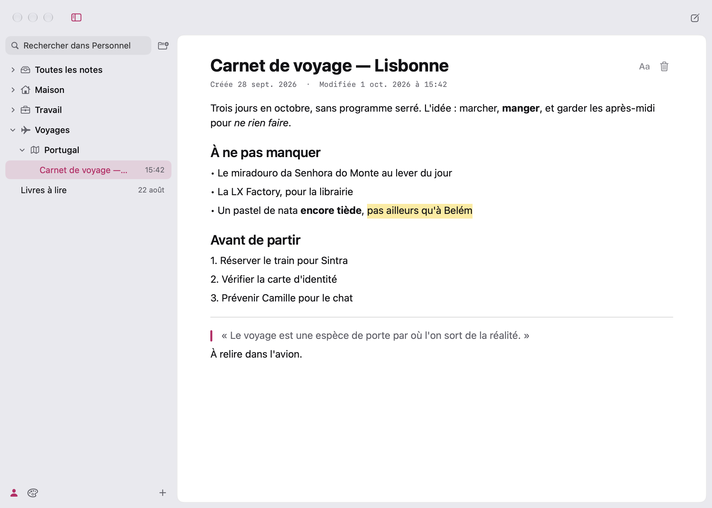
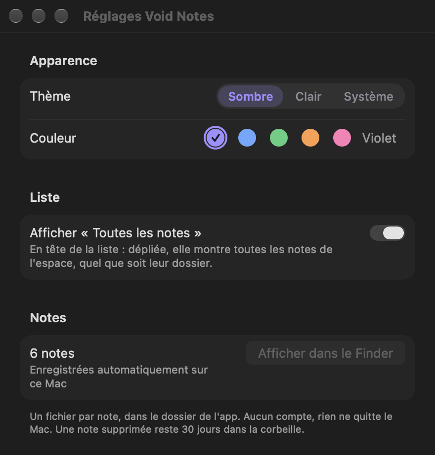
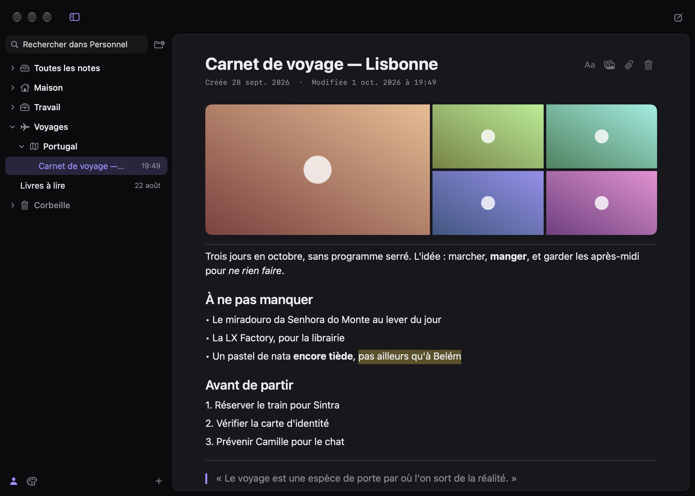
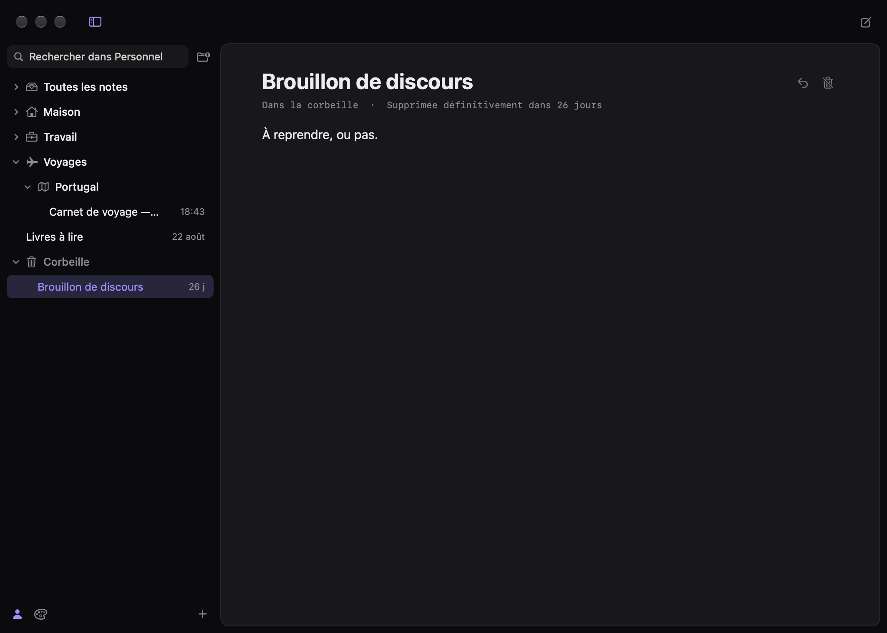
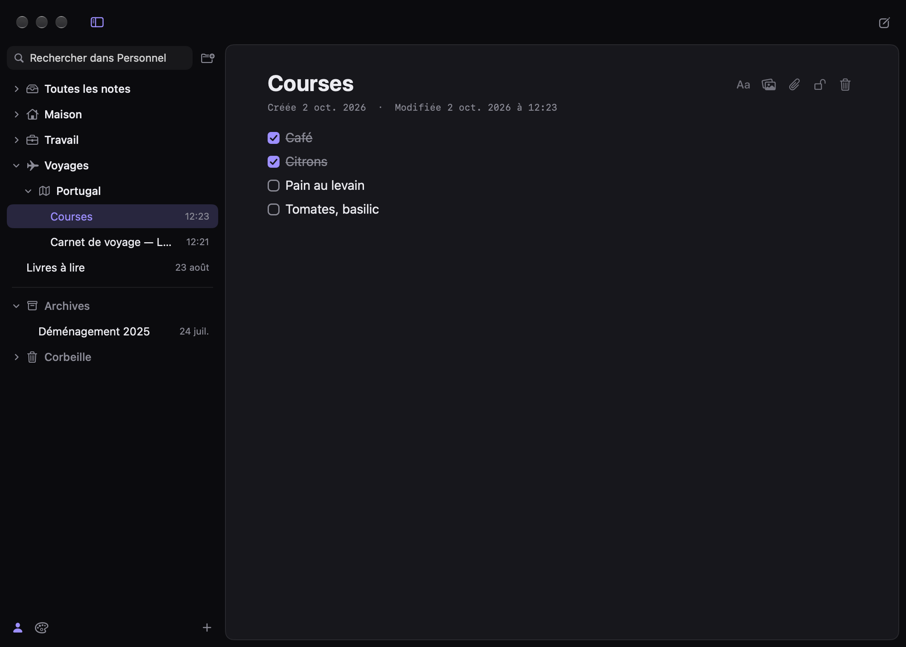
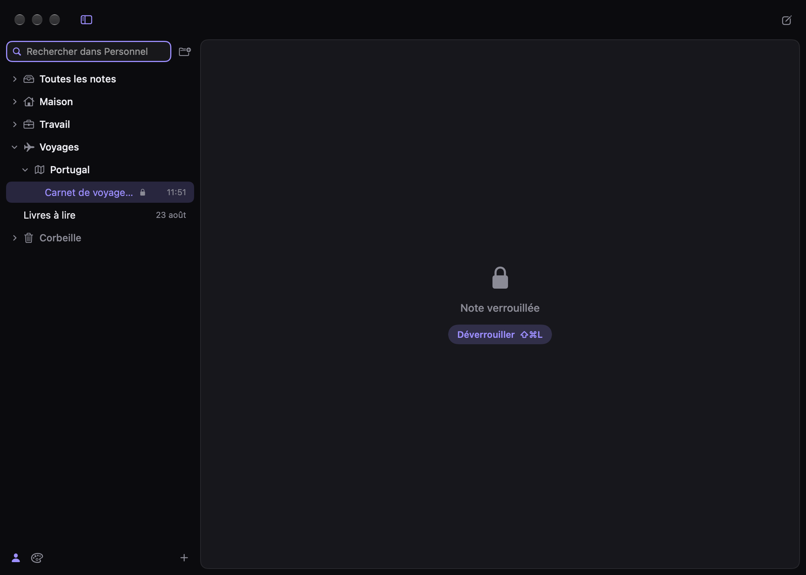
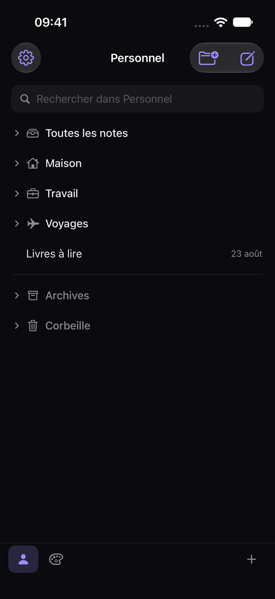
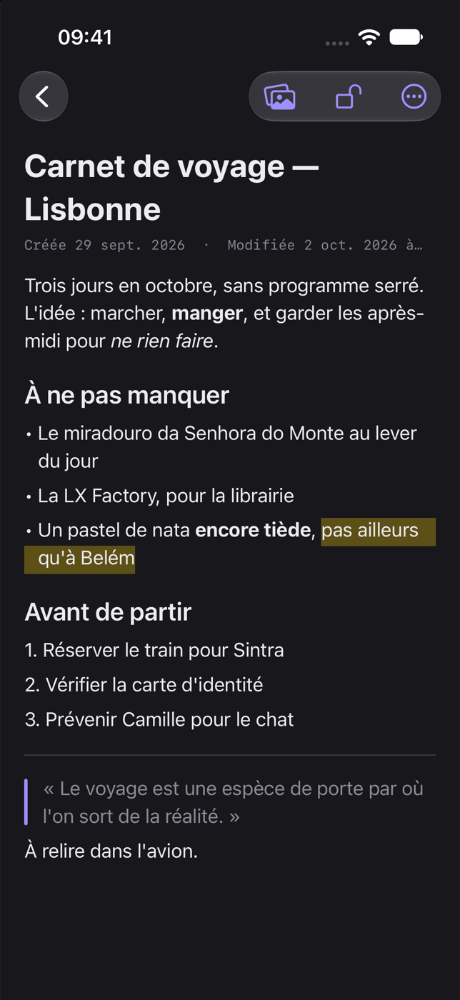

# Void Notes

**Des notes qui s'effacent derrière le texte.** Version **0.2.1** (préversion). Void Notes est le compagnon de [Void](../Void) et de [Void Calendar](../Void%20Calendar) : même palette, même chrome sombre, rien de superflu à l'écran. Une liste, un texte, et la mise en forme se fait en tapant.

- Swift + SwiftUI ; AppKit (`NSTextView`) pour le texte de la note sur Mac, UIKit (`UITextView`) sur iPhone
- Mac : Apple silicon, macOS 14 minimum. iPhone : iOS 17 minimum (cible `VoidNotesiOS`)
- **≈ 9 Mo** (build Release), dont [FluidAudio](https://github.com/FluidInference/FluidAudio) pour séparer les voix ; aucune autre dépendance
- Notes enregistrées sur le Mac, automatiquement ; aucun compte. Synchronisation facultative par un dossier d'iCloud Drive


| | |
|---|---|
|  |  |
|  |  |
|  |  |

## Compiler et lancer

Prérequis : Xcode 16 ou plus récent (projet au format « dossiers synchronisés », comme Void et Void Calendar ; testé avec Xcode 27), un Mac Apple silicon.

**Avec Xcode** : ouvrir `VoidNotes.xcodeproj`, choisir le schéma *VoidNotes* → *My Mac*, puis ⌘R.

**En ligne de commande** :

```bash
xcodebuild -project VoidNotes.xcodeproj -target VoidNotes -configuration Release -arch arm64 COMPILER_INDEX_STORE_ENABLE=NO SYMROOT="$PWD/build/DerivedData/Build/Products" OBJROOT="$PWD/build/DerivedData/Build/Intermediates.noindex" build
```

La cible Mac seule : le schéma *VoidNotes* compile aussi l'app iPhone, dont la signature demande un profil de provisionnement que `xcodebuild` ne sait pas créer seul (Xcode, si : il suffit d'ouvrir le projet et de compiler la cible iPhone une fois pour le renouveler ; avec un compte gratuit, il expire au bout de 7 jours). Les scripts ci-dessous font de même.

```bash
open "build/DerivedData/Build/Products/Release/Void Notes.app"
```

Pour l'installer, ou mettre à jour la copie de `/Applications` après des modifications :

```bash
./scripts/install.sh
```

Le script compile en Release, ferme Void Notes s'il tourne, remplace `/Applications/Void Notes.app` et la rouvre.

Chaque build du schéma *VoidNotes* (⌘B ou ⌘R dans Xcode) fait de même, sans la rouvrir : une post-action du schéma lance `scripts/copy-to-applications.sh`, qui copie l'app compilée (Debug ou Release, celle du build) dans `/Applications`, après avoir fermé la copie qui s'y trouve si elle tourne. Son compte rendu est dans `build/copy-to-applications.log`. Pour s'en passer : Product → Scheme → Edit Scheme… → Build → Post-actions.

**Image disque (DMG)** :

```bash
./scripts/make-dmg.sh
```

Le script compile en Release et produit `build/Void-Notes-<version>.dmg`, soit `build/Void-Notes-0.2.1.dmg` pour cette version (Void Notes + raccourci vers Applications, à glisser-déposer). L'image n'est pas versionnée : la recréer avec le script.

La signature est ad hoc (« Sign to Run Locally »), sans compte développeur, comme Void. L'app est sandboxée ; elle ne lit hors de son conteneur que les fichiers qu'on lui donne à joindre. Elle ne demande d'autorisation que pour écouter : le micro et « Enregistrement audio du système » (Touch ID passe par le dialogue de macOS, sans réglage à accorder). Sa seule connexion réseau télécharge une fois les modèles des voix.

L'icône est générée par script (`swift scripts/make-icon.swift`) : l'éclipse de Void en tête d'une page de texte.

## Écouter et transcrire

Depuis la 0.2.1 (macOS 26, iOS 26), sur Mac et sur iPhone ; ce qui suit décrit le Mac, l'iPhone fait de même avec le micro seul (voir plus bas). Le bouton ondes de la note ouvre un petit panneau — la langue, et ce qu'on entend : le **micro**, le **son du Mac** (un appel Teams/Meet/Zoom, une vidéo) ou **les deux** — puis « Écouter » (⏎). ⇧⌘D démarre aussitôt, comme la dernière fois. Une barre en bas de la note dit qu'on écoute, depuis combien de temps, montre les mots en cours et permet d'arrêter.

**Les onglets** : une note écoutée a trois onglets sous ses enregistrements — **Notes** (ce qu'on y écrit), **Transcription** et **Résumé**. Ce qui est dit s'écrit phrase par phrase dans la transcription, sous une ligne datée par écoute — un nouveau paragraphe après un silence ou quand l'autre source parle. On peut écrire dans ses notes pendant ce temps, rien ne s'y mêle ; une note quittée continue de recevoir les mots. La recherche lit aussi la transcription et le résumé.

**Le résumé** : « Résumer », dans la barre des onglets, écrit le résumé par Apple Intelligence, sur le Mac, en paragraphes (pas de listes) : l'ensemble en bref, puis, pour une longue écoute, un paragraphe par passage d'une dizaine de minutes. Il est écrit dans la langue de l'app ; ce qu'on a noté soi-même compte d'abord.

- **Deux sources** : le micro et le son du Mac ont chacun leur transcripteur. Le son du Mac passe par un *process tap* de Core Audio (repris de Cairn) : macOS ne demande que « Enregistrement audio du système », pas l'enregistrement de l'écran. Si la sortie change pendant l'écoute (un casque branché, des AirPods qui se connectent), la capture se refait sur la nouvelle sortie ; si elle n'y parvient pas, l'app le dit. Sans casque, le micro réentend les haut-parleurs : ses phrases sont retenues 4 s, remises dans l'ordre où elles ont été dites, et ce qu'elles partagent avec le Mac (trois mots de suite ou plus, à quelques secondes près) est retiré.
- **L'enregistrement**, gardé par défaut : AAC mono 16 kHz à 24 kbit/s, **≈ 9 à 12 Mo par heure** (Cairn : deux fichiers à 64 kbit/s, ≈ 60 Mo/h). Écrit pendant l'écoute en ADTS (lisible même si l'app est tuée), il devient à l'arrêt un seul `.m4a` — les deux sources mélangées — joint à la note sous son titre, au-dessus de la transcription ; synchronisé comme toute pièce jointe. Une écoute coupée (l'app tuée, une panne) retrouve son son au lancement suivant, à la fin de sa note.
- **Les enregistrements** ont leur section sous le titre (après l'album d'images), hors du texte : une carte par enregistrement — icône, nom, durée et poids, bouton lecture. Le trombone et le glisser-déposer y mettent aussi les fichiers son. La lecture ouvre **le lecteur au bas de la note**, à la place de la barre d'écoute : lecture/pause, 10 s en arrière et en avant, une ligne de temps (un clic y va, le bouton se fait glisser), le temps écoulé et la durée, × pour le fermer ; il reste ouvert d'une note à l'autre et son nom ramène à la sienne. Le menu de la carte (⋯ ou clic droit) : **Nommer les voix…** (un champ par voix de la note ; chaque nom change partout, en gras, en un seul ⌘Z), Afficher dans le Finder, **Supprimer l'enregistrement…** (après confirmation ; la transcription reste, le fichier part au lancement suivant). La note garde ses enregistrements dans `recordings` (format 13 des notes, depuis la 0.2.1) ; ils se synchronisent comme l'album.
- **La séparation des voix** (Mac) : à l'arrêt, l'enregistrement est relu par le diariseur de [FluidAudio](https://github.com/FluidInference/FluidAudio) (segmentation pyannote, empreintes WeSpeaker, sur le Neural Engine), comme dans Cairn ; chaque phrase va à la voix la plus entendue pendant qu'elle était dite, et son nom s'écrit en gras devant chaque changement : « Voix 1 », « Voix 2 »… — ou « Moi » (le micro) et « Eux » (le Mac), ou ses voix s'il en porte plusieurs. Une seule voix : aucun nom. Une phrase modifiée entre-temps n'est pas touchée. Les modèles (≈ 20 Mo) sont téléchargés une fois depuis Hugging Face (d'où l'autorisation réseau de l'app) — la première fois, pendant l'écoute, pour que sa fin ne les attende pas ; rien de ce qui est entendu ne part. Mesuré : ~0,5 s pour 20 s de son, modèles chargés. Le paquet local `Packages/VoidVoices` enveloppe FluidAudio sans son moteur de normalisation de texte (~8 Mo inutiles ici), et n'est lié qu'à l'app Mac.
- **Réglages → Écoute** : langue et source par défaut, « Garder l'enregistrement », « Séparer les voix ». Les réglages sont en onglets : Général, Apparence, Écriture, Écoute, Synchronisation.
- **Sur iPhone** (iOS 26, sur un iPhone qui a la transcription d'Apple — pas le simulateur) : le bouton ondes, en haut de la note, propose la langue et démarre aussitôt ; seul le **micro** est entendu. La barre d'écoute est au bas de la note, au-dessus du clavier, ou au-dessus des espaces dans la liste ; l'écoute continue l'écran verrouillé ou dans une autre app (mode audio d'arrière-plan), et reprend d'elle-même après un appel (« Reprendre » sinon). Les onglets **Notes · Transcription · Résumé** sont sous le titre (et l'album), comme sur Mac ; « Résumer » écrit le résumé par Apple Intelligence sur l'iPhone. Les voix ne sont pas séparées sur iPhone (FluidAudio n'est lié qu'au Mac) ; l'enregistrement gardé est joint à la note et synchronisé. Ses cartes sont sous l'album, avant les onglets ; la lecture ouvre le lecteur au bas de la note, au-dessus du clavier (boutons d'un doigt, 44 pt), et continue l'écran verrouillé ; un appel la met en pause, retirer le casque aussi. Pas de lecture pendant une écoute : le micro a la main. Le menu de la carte (⋯ ou appui long) : Nommer les voix…, Supprimer l'enregistrement…. Réglages → Écoute : langue, « Garder l'enregistrement ». Le format des notes passe à 13 : une version antérieure à la 0.2.1 les ouvre en lecture seule et ne synchronise plus, il faut mettre l'iPhone à jour lui aussi.

Tout se fait sur l'appareil : transcription d'Apple (`SpeechAnalyzer`, résultats rapides), chaque tampon converti une fois, à l'arrivée, au format du transcripteur — le même tampon est enregistré ; modèles libérés à l'arrêt.

L'auto-test (`-selfTest YES`) vérifie aussi l'écoute : où vont les mots, l'écho, l'ordre des deux sources, l'attribution des voix et l'endroit des noms, l'enregistrement (ADTS lisible, `.m4a`, mélange, poids), les enregistrements dans leur section, le lecteur (±10 s, bornes), les voix renommées en un ⌘Z, la suppression ; de bout en bout, une voix française de synthèse jouée à la place du micro, transcrite et jointe à la note ; et deux voix de synthèse séparées pour de vrai par FluidAudio. `-demo YES -listening YES` montre une écoute en cours, `-listenOptions YES` le panneau du bouton, `-recording YES` une note enregistrée, son lecteur ouvert (`-nameVoices YES` : la feuille des noms) (avec `-snapshot` sur Mac ; `-settingsTab listening -showSettings YES` pour l'onglet Écoute).

## Écrire

On tape les marques de Markdown, elles disparaissent et le texte prend sa forme aussitôt :

| On tape | On obtient |
|---|---|
| `# ` en début de ligne | Titre |
| `## ` | Sous-titre |
| `### ` | Intertitre |
| `- ` ou `* ` | Liste à puces |
| `1. ` | Liste numérotée |
| `[] ` ou `[ ] ` | Case à cocher, à faire |
| `[x] ` | Case cochée |
| `> ` | Citation |
| `**texte**` | **Gras** |
| `*texte*` ou `_texte_` | *Italique* |
| `==texte==` | Surligné (jaune, comme au marqueur : une bande sous la moitié basse des lettres, de la largeur des mots) |
| `~~texte~~` | ~~Barré~~ |
| `` `texte` `` | `Code` (chasse fixe, sur un fond léger) |
| `---` seul sur sa ligne | Séparateur |

- La première ligne d'une note vide est son titre ; Entrée revient au texte normal. Quand la note se termine par un titre, un clic en dessous ou ↓ ouvre aussi la ligne de texte suivante.
- Dans une liste, Entrée crée l'élément suivant (le numéro avance tout seul) ; Entrée sur un élément vide termine la liste ; Retour arrière juste après la puce la retire.
- **Listes imbriquées** : Tab (ou ⌘]) décale un élément de liste d'un cran, quatre au plus ; ⇧Tab (ou ⌘[) le ramène. Entrée garde le retrait ; Entrée sur un élément vide en retrait, ou Retour arrière juste après sa puce, le ramène d'abord d'un cran. Hors d'une liste, Tab reste une tabulation.
- **Numéros qui suivent** : insérer, supprimer ou décaler un élément d'une liste numérotée renumérote les suivants (dans la même annulation). Chaque cran compte pour lui-même, une sous-liste repart de 1 ; une liste commence au numéro tapé (`3. ` donne 3, 4, 5…).
- **Listes à cocher** : distinctes des listes à puces. Un clic sur la case la coche ou la décoche (⇧⌘U au clavier, pour la ligne du curseur ou toutes celles de la sélection) ; une ligne cochée s'estompe et son texte est **barré**. Entrée crée la case suivante, toujours à faire ; Entrée sur une case vide termine la liste ; Retour arrière juste après la case la retire. `- [ ] ` et `- [x] `, comme en Markdown, donnent la même chose. Format → « Liste à cocher » (⌥⌘6) met des cases aux lignes sélectionnées, ou les retire si elles en ont toutes.
- Dans une citation, Entrée continue la citation ; Entrée sur une ligne vide la termine.
- Retour arrière au tout début d'un titre ou d'une citation le remet en texte normal.
- `*`, `_`, `=` et `--` isolés restent tels quels (`2 * 3`, `nom_de_fichier`, `a == b`).
- Un séparateur se retire d'un Retour arrière, depuis sa ligne ou depuis le début de la ligne suivante.
- **Coller du Markdown** (⌘V) : un texte qui en contient — titres `#`, listes, cases, citations, blocs de code, `**gras**`, `*italique*`, `~~barré~~`, `==surligné==`, `` `code` ``, liens `[texte](adresse)` — arrive mis en forme, les marques disparues. Sa première ligne continue la ligne du curseur quand on colle au milieu d'une ligne. Un texte sans marque arrive tel quel, dans le style de la note ; « Coller et adapter le style » (⌥⇧⌘V) colle toujours en texte brut, marques comprises.

**Personnaliser le texte.** Le bouton **Aa**, dans la note au bout de la ligne du titre (à côté du trombone et de la corbeille, comme dans Irum), ouvre un panneau qui agit sur la sélection, ou sur ce qui sera tapé ensuite :

- **Style** : Titre, Sous-titre, Intertitre, Texte (le style en cours est coché, les autres rappellent leur raccourci) ;
- **Caractères** : gras, italique, barré, code, surlignage — en jaune uniquement ;
- **Graisse** : Léger, Normal, Moyen, Semi-gras, Gras ;
- **Paragraphe** : liste à cocher, liste à puces, liste numérotée, retrait, citation, séparateur ;
- **Lien** : sélectionner le texte, taper l'adresse (`void.app`, `https://…`, ou une adresse mail), Entrée. Sans sélection, l'adresse s'écrit elle-même, en lien ; dans un lien, le champ montre son adresse pour la changer, et ✕ le retire (le texte reste). Aussi Format → « Lien… » (⌘K) et « Retirer le lien ».

Il n'y a aucun choix de couleur : le texte suit le thème.

**Liens.** Soulignés dans la couleur d'accent ; un clic les ouvre (le survol montre l'adresse). Ce qu'on tape au bout d'un lien n'en fait pas partie ; au milieu, si. Sur iPhone : bouton 🔗 au-dessus du clavier, puis un toucher sur le lien l'ouvre.

**Orthographe et grammaire.** Comme dans un traitement de texte : un mot inconnu est souligné d'une vague **rouge**, une faute de grammaire d'une vague **bleue** — dans la langue du texte, par le correcteur de macOS. Le mot en cours de frappe n'est pas souligné tant que le curseur y est. Clic droit sur un mot souligné : les corrections proposées, ce que le correcteur reproche (grammaire), « Ignorer » (pour cette note, tant qu'elle est ouverte) et « Ajouter au dictionnaire ». Les liens et la ligne « Source : » ne sont pas lus. Réglages → Écriture pour couper l'un ou l'autre (aussi Édition → Orthographe et grammaire). La grammaire n'est proposée que si la version de macOS la vérifie pour les apps : l'app le demande une fois à macOS ; **macOS 27 n'en relève plus aucune**, le réglage « Vérifier la grammaire » n'apparaît donc pas (il reviendra de lui-même si macOS la rétablit). Sur iPhone, iOS souligne en rouge les fautes d'orthographe (réglage « Vérifier l'orthographe ») ; iOS n'a pas de correcteur de grammaire ouvert aux apps : pas de bleu sur iPhone.

Les mêmes mises en forme sont dans le menu **Format**, pour une sélection ou au clavier : ⌘B, ⌘I, ⇧⌘E (surligner), ⇧⌘X (barré), Code, ⌘K (lien), ⌥⌘1 / 2 / 3 (titres), ⌥⌘0 (texte), ⌥⌘6 (cases à cocher), ⇧⌘U (cocher ou décocher), ⌥⌘7 (puces), ⌥⌘8 (numéros), ⌘] / ⌘[ (retrait), ⌥⌘9 (citation), plus Graisse et Séparateur.

**Dates.** Sous le premier paragraphe de la note (son titre), une ligne en petits caractères à chasse fixe donne le jour de création, puis la dernière modification dite comme on la dirait — « aujourd'hui à 15:41 », « hier à 9:02 », « le 1 oct. à 18:20 » ; l'année n'apparaît que si ce n'est pas celle en cours. Sur Mac, l'infobulle de la ligne donne les deux dates en entier. Elle n'est jamais tronquée (sur iPhone, aux grandes tailles de texte, elle rapetisse un peu). Elle est dessinée par l'app : elle ne fait pas partie du texte, ne se sélectionne pas et n'est pas enregistrée dans `text`.

**S'effacer en écrivant.** Dès qu'on tape dans la note, ce qui l'entoure se retire : sur Mac, la liste s'estompe, les boutons du titre et ceux de la barre de la fenêtre disparaissent ; ils reviennent au premier mouvement du pointeur, à un clic ou au défilement. Sur iPhone, les boutons en haut à droite s'effacent (le retour reste) et reviennent quand on fait défiler ou qu'on touche la note.

**Ce qui s'efface aussi.** Les puces et les numéros des listes sont en gris, le texte de l'élément devant. Dans la liste du Mac, les dossiers sont en gris et les notes en clair ; les chevrons des dossiers n'apparaissent qu'avec le pointeur sur la liste. Les icônes de la barre de la fenêtre sont grises : l'accent est réservé à la note (sélection, curseur, cases, citations, liens).

Autres raccourcis : ⌘N nouvelle note, ⇧⌘N nouveau dossier, ⇧⌘A joindre un fichier, ⇧⌘⌫ mettre la note à la corbeille, ⇧⌘L verrouiller ou déverrouiller la note, ⌃⌘A archiver ou désarchiver, ⌃⌘P épingler ou désépingler, ⌘F rechercher (Échap pour en sortir, Entrée pour ouvrir le premier résultat ; les mots trouvés sont marqués dans la note ouverte tant que la recherche dure, et le premier est amené à l'écran), ⌥⌘E exporter la note en Markdown, ⌘P imprimer, ⌥⌘↑ / ⌥⌘↓ note précédente / suivante, ⌃⌘S afficher ou masquer la liste, ⌘, réglages.

## Langue

L'interface est en **français ou en anglais**, comme Void : celle du système par défaut (le français si c'est la première langue du système, l'anglais pour toute autre langue), ou celle choisie dans **Réglages (⌘,) → Langue** : Langue du système, Français ou English. Le choix est celui que macOS garde pour l'app (Réglages Système → Général → Langue et région → Apps ; sur iPhone, Réglages → Void Notes → Langue) et s'applique au lancement suivant : sur Mac, « Redémarrer Void Notes » relance l'app tout de suite, après avoir tout enregistré et envoyé comme à chaque fermeture ; sur iPhone, la prochaine ouverture.

Les textes de l'interface sont dans `Shared/Localizable.xcstrings` (commun au Mac et à l'iPhone), les phrases de Siri et Raccourcis dans `Shared/AppShortcuts.xcstrings`, la demande d'accès à Face ID dans `VoidNotesiOS/InfoPlist.xcstrings`. Les textes français du code servent de clés ; la région de développement est l'anglais (`DEVELOPMENT_LANGUAGE = en`), pour qu'un système dans une autre langue reçoive l'anglais : chaque texte a donc aussi sa valeur française, que `./scripts/french-source-strings.py` complète après l'ajout de textes. Le contenu des notes n'est jamais traduit ; les noms par défaut (« Personnel », « Nouveau dossier »…) sont ceux de la langue du moment où l'élément est créé.

## Apparence

Réglages (⌘,) → Apparence, comme dans Void :

- **Thème** : Sombre (par défaut), Clair ou Système.
- **Couleur d'accent** (violet, bleu, vert, orange, rose), en tons pastel, les mêmes que Void. Choix assumé de la douceur en thème clair : un texte ou un trait en couleur d'accent (curseur, liens, barre des citations) n'y atteint qu'environ 2:1 (au moins 8:1 en thème sombre). Ce qui est posé sur la couleur est foncé, au moins 7,5:1 : la coche des cases cochées, les boutons principaux. Sur iPhone, les actions de balayage (Archiver, Épingler, Restaurer), dont iOS dessine le libellé en blanc, prennent un ton profond de la couleur (au moins 5,5:1).
- **Teinte de la fenêtre** : colore le cadre (liste des notes, barre de la fenêtre, marge autour de la note) et la note elle-même. Neutre (le gris d'origine, par défaut) ou une de huit teintes pastel (rose, pêche, citron, sauge, menthe, ciel, lavande, mauve) ; un point signale celles qui sont complémentaires de la couleur d'accent. Une touche de cette couleur, de 4 à 20 % (« Intensité de la teinte »), se mêle à une base doucement chaleureuse (crème en clair, brun très sombre en sombre) . La note est faite du même fond que la liste — même teinte, même dégradé, même transparence — à peine éclairci (un voile blanc de 40 % en clair, 5 % en sombre) pour rester une feuille posée sur son cadre. Le texte secondaire (dates, puces, citations, éléments de la liste) passe alors en gris chaud, au moins 4,5:1 sur le cadre comme sur la note. Avec « Dégradé » (par défaut), deux halos diffus à la manière de Firn : la teinte en haut à droite, sa complémentaire en bas à gauche.
- **Sur Mac**, un cadre teinté est légèrement translucide (82 %, bureau flouté dessous), barre de la fenêtre et note comprises ; la note rapide de la barre des menus aussi. « Réduire la transparence » (Réglages Système → Accessibilité) rend le tout opaque. **Sur iPhone**, la teinte et son dégradé passent sous la barre de navigation, dans la liste comme dans la note.

## Note rapide

Pour noter quelque chose sans chercher la fenêtre :

- **Barre des menus (Mac)** : l'icône ✎ ouvre un petit champ. La première ligne est le titre, les marques Markdown sont lues (`- [ ] lait`, `**urgent**`…) ; ⌘↩ ajoute la note en tête de la liste de l'espace affiché, sans quitter la note en cours. Tant que l'icône est là, Void Notes reste ouvert quand on ferme sa fenêtre. Réglages → Liste → « Icône dans la barre des menus » pour la retirer.
- **Raccourcis, Siri, Spotlight (Mac et iPhone)** : l'action « Nouvelle note » ajoute une note avec le texte donné, sans ouvrir l'app (« Nouvelle note dans Void Notes »). Sur iPhone, elle se met aussi sur le bouton Action, ou dans un raccourci de la feuille de partage.

## Exporter et imprimer

- **Une note** : Fichier → « Exporter en Markdown… » (⌥⌘E). Un fichier `.md` lisible partout ; une note avec des images ou des fichiers devient un dossier qui contient le `.md` et une copie de ses fichiers dans `fichiers/`, vers lesquels pointent les liens. Sur iPhone : « … » → « Exporter en Markdown » (feuille de partage ; les images y sont nommées, pas jointes).
- **Toutes les notes** : Fichier → « Exporter toutes les notes… », puis un dossier. Un dossier « Void Notes – <date> » y est créé : une note par fichier, rangées comme dans la liste (un dossier par espace s'il y en a plusieurs, par dossier et sous-dossier, et « Archives »). La corbeille n'est pas exportée, ni les notes verrouillées (exportez-les une à une, ouvertes). Un second export ne remplace jamais le premier.
- **Le format** : titres `#`, `##`, `###`, listes `-`, `1.`, `- [ ]`, `- [x]` (retrait de quatre espaces par cran), citations `>`, `---`, `**gras**`, `*italique*`, `~~barré~~`, `==surligné==`, `` `code` ``, liens `[texte](adresse)`, images ``. Les graisses autres que le gras ne s'écrivent pas.
- **Imprimer** : Fichier → « Imprimer… » (⌘P), en clair quel que soit le thème, avec les dates, les cases et les citations, sans les boutons ni l'album. « PDF » dans le panneau d'impression en fait un PDF.

## Images et pièces jointes

Une note peut contenir des images et des fichiers de n'importe quel type (PDF, archive, document…).

- **Ajouter des images** : le bouton image au bout de la ligne du titre, avant le trombone (le même que dans Irum) — « Depuis la photothèque » ou « Depuis un fichier… » —, ou Fichier → « Ajouter des images… ». Une image glissée depuis le Finder, collée (⌘V) ou choisie avec le trombone va au même endroit.
- **Les images** s'affichent comme dans Irum : un **album** sous le titre et les dates — une grande image et de plus petites à côté, cinq au plus, la dernière indiquant « +N » s'il y en a d'autres —, suivi d'un trait qui le sépare du texte. Un clic ouvre l'image en grand (flèches à l'écran ou au clavier pour passer aux autres, corbeille pour la retirer) ; clic droit : voir, afficher dans le Finder, supprimer.
- **Joindre un fichier** : le trombone, Fichier → « Joindre un fichier… » (⇧⌘A), glisser depuis le Finder sur le texte, ou coller (⌘V) des fichiers copiés dans le Finder. Il s'affiche dans le texte, en carte : icône, nom, type et taille.
- Chaque fichier joint occupe sa propre ligne, à l'endroit du curseur (ou du dépôt). Elle se sélectionne d'un clic, se supprime comme un caractère, et s'annule avec ⌘Z. **Double-clic** : elle s'ouvre dans son app.
- L'app garde **une copie** du fichier avec la note : l'original peut être déplacé ou supprimé. Une note qui ne contient qu'un fichier porte son nom dans la liste.

## Verrouiller une note

Une note sensible se verrouille : elle ne s'affiche plus qu'après **Touch ID**.

- **Verrouiller** : le cadenas au bout de la ligne du titre (sur iPhone : « … » → « Verrouiller »), ⇧⌘L, Fichier → « Verrouiller la note », ou clic droit sur la note → « Verrouiller ». La note est cachée aussitôt, sans rien demander.
- **Déverrouiller** : le bouton au milieu de la note, ou ⇧⌘L. macOS demande Touch ID (ou l'Apple Watch). **Sans Touch ID** — Mac qui n'en a pas, aucune empreinte enregistrée, capot fermé, doigt non reconnu — c'est le **mot de passe de l'ordinateur** qui est demandé, dans le même dialogue ; les infobulles le disent alors à la place de « Touch ID ». L'app ne voit ni empreinte ni mot de passe.
- La note **se reverrouille toute seule** dès qu'on passe à une autre note, que l'écran se met en veille ou se verrouille, et quand on quitte l'app. Sur iPhone, elle est aussi couverte dès que l'app n'est plus au premier plan (sélecteur d'apps, centre de contrôle) et reverrouillée en arrière-plan. Le cadenas (ou ⇧⌘L) la recache tout de suite.
- **Retirer le verrou** : Fichier → « Retirer le verrou… » ou clic droit sur la note. Sur une note encore cachée, Touch ID est demandé d'abord.
- Dans la liste, une note verrouillée garde son **titre**, suivi d'un petit cadenas ; son aperçu n'apparaît plus et la recherche ne la trouve que par son titre. Elle reste verrouillée dans la corbeille.
- **Limite à connaître** : c'est un verrou d'affichage. Le fichier de la note n'est **pas chiffré** : il reste lisible dans le dossier des notes par qui a accès à la session du Mac. (Un chiffrement lié à Touch ID demande le trousseau protégé, qu'une app signée ad hoc ne peut pas utiliser.)

## Archives

Archiver une note la met de côté sans la supprimer : elle quitte son dossier dans la liste et « Toutes les notes », et se retrouve sous **« Archives »**, sans limite de temps.

- **Archiver** : clic droit sur la note → « Archiver », Fichier → « Archiver la note » (⌃⌘A), ou clic droit sur une sélection de plusieurs notes. La date de la note ne change pas ; la note voisine s'ouvre.
- « Archives » apparaît dès qu'une note de l'espace est archivée, **à l'écart sous les dossiers et les notes**, juste avant la corbeille ; un clic la déplie. Chaque espace a les siennes.
- Une note archivée reste une note : elle se lit, **s'écrit**, se verrouille, et la **recherche la trouve**. Sous son titre, « Archivée » précède les dates.
- **Désarchiver** : clic droit → « Désarchiver », ou ⌃⌘A. La note revient dans le dossier où elle était, qui se déplie.
- Mise à la corbeille puis restaurée, une note archivée retourne aux archives. Une note vide ne s'archive pas.

## Épingler

Une note épinglée se met **tout en haut de la liste**, au-dessus de « Toutes les notes » et des dossiers, suivie d'une petite épingle.

- **Épingler** : clic droit sur la note → « Épingler », Fichier → « Épingler la note » (⌃⌘P), ou clic droit sur une sélection de plusieurs notes. Sur iPhone : balayer la note vers la droite, ou appui long → « Épingler ». La date de la note ne change pas.
- La note épinglée n'apparaît qu'une fois : en haut, et plus dans son dossier (elle y reste rangée). Elle est aussi la première de « Toutes les notes » et des résultats de recherche.
- **Désépingler** : même chemin (ou ⌃⌘P) ; la note revient dans son dossier, qui se déplie.
- Archiver une note la désépingle ; une note archivée ou vide ne s'épingle pas.

## Corbeille

Supprimer une note (⇧⌘⌫, la corbeille au bout du titre, ou clic droit) la met à la **corbeille**, sans confirmation : elle y reste **30 jours**, puis disparaît définitivement au lancement suivant de l'app.

- « Corbeille » est la dernière ligne de la liste, à l'écart des dossiers (un trait la sépare, avec « Archives », du reste de l'arbre), dès qu'il y a quelque chose dedans ; un clic la déplie. Chaque note y affiche les jours qui lui restent. Chaque espace a la sienne.
- Un clic sur une note de la corbeille la montre, en lecture seule — son texte en gris — ; sous son titre, ce qui l'attend.
- **Annuler** (iPhone) : une note mise à la corbeille laisse quelques secondes, en bas de la liste, « Mise à la corbeille · Annuler », qui la remet où elle était.
- **Restaurer** : la flèche au bout du titre (la suppression définitive, la corbeille marquée d'une croix, est tenue à l'écart), ou clic droit → « Restaurer ». La note revient dans son dossier (hors de tout dossier s'il n'existe plus), avec sa date et ses pièces jointes.
- **Supprimer définitivement** : clic droit ou ⇧⌘⌫ sur une note de la corbeille, après confirmation. Clic droit sur « Corbeille » → « Vider la corbeille… ».
- La recherche et ⌥⌘↑ / ⌥⌘↓ ignorent la corbeille. Une note vide n'y va pas : elle est simplement retirée.

## Dossiers


La barre latérale est un arbre. Un clic sur un dossier le déplie sur place : ses sous-dossiers, puis ses notes, apparaissent dessous, en retrait. Un second clic le replie. À chaque niveau, **les dossiers viennent avant les notes** : les notes qui ne sont dans aucun dossier suivent les dossiers. Seules les notes épinglées sont au-dessus de tout (voir « Épingler »). Dossiers et notes ont la même hauteur de ligne : une note, c'est son titre et, au bout de la ligne, la date de sa dernière modification (l'aperçu du texte est dans l'infobulle).

En tête de l'arbre, **« Toutes les notes »** se déplie de la même façon et montre toutes les notes de l'espace, de la plus récente à la plus ancienne, quel que soit leur dossier. Cette ligne est optionnelle : **Réglages (⌘,) → Liste → « Afficher « Toutes les notes » »** ; sans elle, la liste commence aux dossiers (après les notes épinglées).

- **Ranger une note** : la faire glisser sur un dossier (il se borde de la couleur d'accent, puis se déplie pour la montrer), ou parmi les notes d'un dossier. La déposer sous la liste la sort de tout dossier. Aussi par clic droit sur la note → « Déplacer vers ». La date de modification ne change pas.
- **Ranger un dossier dans un autre** : le faire glisser sur ce dossier ; il devient un sous-dossier et emporte ses propres sous-dossiers et ses notes. Le déposer sous la liste le remet au premier niveau. Aussi par clic droit sur le dossier → « Déplacer vers » (sur iPhone, appui long). Un dossier ne peut pas aller dans lui-même ni dans un de ses sous-dossiers.
- **Sélectionner plusieurs lignes** (notes et dossiers) : ⌘-clic ajoute ou retire une ligne, ⇧-clic prend tout depuis la dernière ligne choisie (ou la note ouverte) ; sans clavier, clic droit → « Sélectionner ». Un clic simple revient à une seule note. Le clic droit sur la sélection agit sur l'ensemble : « Déplacer vers » (notes et dossiers), « Déplacer vers l'espace », « Mettre à la corbeille » — ou « Supprimer… », avec confirmation, si elle contient des dossiers ; ⇧⌘⌫ fait de même. Glisser une des lignes sélectionnées les range toutes.
- **Créer un dossier, une note** : les deux boutons à droite de la recherche — le dossier, puis la note —, ou ⇧⌘N et ⌘N. Quand la liste est masquée, la nouvelle note est en haut à droite de la fenêtre. Le nom se tape aussitôt ; pendant qu'on le tape, un clic sur l'icône ouvre le choix d'icône.
- **Nouvelle note, sous-dossier, renommer, changer l'icône, supprimer** : clic droit sur un dossier. Trente icônes au choix.
- ⌘N crée la note dans le dossier de la note ouverte.
- **Supprimer un dossier** retire aussi ses sous-dossiers, jamais les notes : elles reviennent dans le dossier au-dessus (ou dans aucun).
- **La recherche** donne une liste à plat, dans tous les dossiers de l'espace, même repliés ; ouvrir un résultat déplie son dossier. Elle lit aussi le **nom des dossiers** : « Recettes » trouve les notes de « Recettes » et de tous ses sous-dossiers, et les mots peuvent se partager entre le dossier et le texte (« recettes pommes »).
- Les dossiers dépliés sont retrouvés tels quels au lancement.

## Espaces

Comme dans Void, les notes se répartissent en espaces (Personnel, Travail…) : chaque espace a ses dossiers et ses notes, et la barre latérale n'en montre qu'un à la fois. Au premier lancement il y en a un, **Personnel**, où se trouvent toutes les notes existantes.

- **Changer d'espace** : ses icônes sont en bas de la barre latérale ; un clic, ou un balayage horizontal à deux doigts sur la barre. Chaque espace rouvre la note qu'il montrait.
- **Créer un espace** : le « + » en bas à droite de la barre, qui apparaît avec le pointeur sur la barre (ou clic droit sur la barre → « Nouvel espace… ») ; sur iPhone, le petit « + » juste après les icônes des espaces — un nom, une icône parmi seize.
- **Le nom de l'espace** s'affiche un instant à côté de ses icônes quand on en change, et tant que le pointeur est sur la barre.
- **Renommer, changer l'icône, supprimer** : clic droit sur l'icône de l'espace. Supprimer un espace ne supprime aucune note : ses dossiers et ses notes vont dans le premier des autres espaces. Le dernier espace ne se supprime pas.
- **Changer une note ou un dossier d'espace** : clic droit → « Déplacer vers l'espace ». Une note quitte alors son dossier ; un dossier part avec ses sous-dossiers et leurs notes.
- La recherche, ⌘N, ⇧⌘N et ⌥⌘↑ / ⌥⌘↓ agissent dans l'espace affiché.

## Où sont les notes

Sur ce Mac, dans le conteneur de l'app, **un fichier JSON par note** :

```
~/Library/Containers/app.void.notes/Data/Library/Application Support/Void Notes/notes/<identifiant>.json
```

Réglages (⌘,) → Notes → « Afficher dans le Finder » ouvre ce dossier.

**Enregistrement automatique.** Il n'y a pas de bouton « Enregistrer ». Chaque frappe met la note à jour en mémoire ; son fichier est réécrit 0,4 s après la dernière frappe, et tout de suite quand on passe à une autre app, qu'on ferme la fenêtre ou qu'on quitte. L'écriture est atomique : un fichier n'est jamais à moitié écrit. Seule la note modifiée est réécrite.

**Format.** Le texte est enregistré en clair, la mise en forme à côté :

```json
{
  "created" : "2026-10-01T12:05:12.345Z",
  "id" : "6F1E2C3A-…",
  "modified" : "2026-10-01T12:19:40.812Z",
  "runs" : [
    { "block" : "title", "length" : 8, "start" : 0 },
    { "bold" : true, "length" : 4, "start" : 21 }
  ],
  "text" : "Courses\n• Pain au levain\n• Café",
  "version" : 5
}
```

- `text` : le texte tel qu'on le lit, puces (`• `), numéros (`1. `) et cases (`☐ ` à faire, `☑ ` cochée) compris. Le titre d'une note est sa première ligne non vide, l'aperçu les lignes suivantes : rien de plus n'est stocké.
- `runs` : les passages mis en forme, en positions UTF-16 dans `text`. `block` vaut `title`, `heading`, `subheading`, `quote`, `divider` (un séparateur est un paragraphe dont le texte est `---`) ou `source` (la ligne « Source : » d'une note envoyée par Void, en petit et en mono) ; `bold`, `italic`, `highlight`, `strike` (barré), `code` et `weight` (`light`, `medium` ou `semibold`) s'y ajoutent ; `indent` (1 à 4) est le retrait d'un élément de liste. Une pièce jointe est un caractère `\uFFFC` de `text`, avec un passage `{ "attachment" : "nom du fichier", "length" : 1, … }`. Aucune police ni couleur n'est enregistrée : elles sont recalculées à l'affichage, d'après le thème.
- `folder` : identifiant du dossier de la note ; absent si elle n'est dans aucun.
- `space` : identifiant de l'espace de la note ; absent dans les fichiers d'avant les espaces, qui sont lus comme étant dans le premier.
- `deleted` : date de mise à la corbeille ; absent pour une note qui n'y est pas.
- `locked` : `true` pour une note verrouillée ; absent sinon.
- `archived` : `true` pour une note archivée ; absent sinon.
- `pinned` : `true` pour une note épinglée ; absent sinon.
- `version` : version du format — 2 depuis les séparateurs, le surlignage et les graisses, 3 depuis les dossiers, 4 depuis les espaces, 5 depuis la corbeille et les pièces jointes, 6 depuis la ligne « Source : », 7 depuis l'album d'images (`photos` : les noms des images, dans l'ordre), 8 depuis le verrou (`locked`), 9 depuis les archives (`archived`), 10 depuis les liens, 11 depuis l'épinglage (`pinned`), 12 depuis le barré, le code et les listes imbriquées ; les fichiers des versions précédentes se lisent tels quels. Un fichier écrit par une version ultérieure de l'app est affiché mais jamais réécrit.

**Dossiers.** Ils sont dans un seul petit fichier, à côté du dossier `notes` : `Void Notes/folders.json` (pour chaque dossier : `id`, `name`, `icon` — un nom de symbole SF —, `parent` pour un sous-dossier, et `space`, son espace). Un dossier ne liste pas ses notes : c'est chaque note qui dit où elle est rangée.

**Pièces jointes.** Les fichiers joints sont copiés dans `Void Notes/attachments/<identifiant de la note>/`, sous leur nom (suivi d'un numéro si le nom est pris). Un fichier dont l'image a été retirée du texte reste là tant que l'app tourne, pour que ⌘Z le ramène ; il est retiré au lancement suivant. Le dossier d'une note disparaît avec elle, quand elle est supprimée définitivement.

**Cas particuliers.**

- Une note laissée vide n'est pas gardée : elle n'est jamais écrite sur le disque et disparaît de la liste quand on la quitte.
- Un fichier illisible n'est jamais écrasé : il est déplacé dans le sous-dossier `illisibles/` et la liste le signale.
- Une note écrite par une version plus récente de l'app est montrée en lecture seule ; elle ne va pas à la corbeille (l'app le dit) : il faut mettre l'app à jour pour la supprimer.
- Une note à la corbeille garde son fichier (avec `deleted`) et ses pièces jointes ; ils sont retirés 30 jours plus tard, au lancement, ou quand on la supprime définitivement.
- Les réglages (thème, couleur d'accent, teinte de la fenêtre, « Toutes les notes » affichée ou non, liste affichée, dernière note ouverte) sont dans les préférences de l'app (`UserDefaults`, domaine `app.void.notes`), avec les mêmes clés et valeurs par défaut que Void pour le thème, l'accent et la teinte (`chromeTint`, `chromeTintIntensity`, `chromeTintGradient`).

**Espaces.** De même, `Void Notes/spaces.json` (pour chaque espace : `id`, `name`, `icon`, `created`), dans l'ordre de leur création.

**Sauvegarder ses notes** : copier le dossier `notes`, le dossier `attachments` et, pour garder le rangement, `folders.json` et `spaces.json`. Les remettre en place, app fermée, suffit à les retrouver.

## Sur iPhone

La cible `VoidNotesiOS` du même projet, faite comme celle d'Irum : le modèle, le stockage, la synchronisation, les règles de frappe et le format des notes sont dans `Shared/` et servent aux deux apps ; les écrans et la vue de texte sont écrits pour l'iPhone.

| | | |
|---|---|---|
|  |  |  |

- **Liste** : le même arbre que sur Mac (« Toutes les notes », dossiers et sous-dossiers qui se déplient sur place, notes sans dossier, puis « Archives » et « Corbeille » à l'écart). En haut à droite : la loupe, qui fait apparaître la recherche (« Annuler » la range), le nouveau dossier et la nouvelle note ; en bas, les espaces et leur « + ». La liste et les notes suivent la taille du texte choisie dans iOS. Un toucher ouvre une note ; un balayage vers la gauche l'archive ou la met à la corbeille, vers la droite l'épingle ; un appui long la range dans un dossier, l'envoie dans un autre espace, la verrouille. Appui long sur un dossier ou un espace pour le renommer, changer son icône, le supprimer ; sur un dossier, aussi pour le ranger dans un autre.
- **Note** : la même mise en forme à la volée (`# `, `## `, `- `, `[] `, `**gras**`, `==surligné==`, `---`…), les cases à cocher d'un toucher, les dates sous le titre, l'album d'images. Au-dessus du clavier, dans une pastille : « Aa » (style du paragraphe, barré, code, lien, citation, séparateur, retrait d'une liste), les trois listes, gras, italique, surlignage, et la touche qui range le clavier. Cocher une case se sent aussi (retour haptique). En haut : ajouter des images (photothèque) ou joindre un fichier, et le reste — verrouiller (Face ID) compris — dans « … ».
- **Écouter** : le bouton ondes en haut de la note, les onglets Notes · Transcription · Résumé sous son titre (voir « Écouter et transcrire »).
- **Réglages** (roue dentée) : thème, couleur d'accent, teinte de la fenêtre (intensité, dégradé), langue, « Toutes les notes », écoute, dossier de synchronisation — choisir le dossier « Void Notes » d'iCloud Drive, le même que sur le Mac.

Compiler et lancer dans le simulateur :

```bash
xcodebuild -project VoidNotes.xcodeproj -scheme VoidNotesiOS -destination 'platform=iOS Simulator,name=iPhone 17' -derivedDataPath build/DerivedData build
xcrun simctl install booted "build/DerivedData/Build/Products/Debug-iphonesimulator/VoidNotesiOS.app"
xcrun simctl launch booted app.void.notes -demo YES -theme dark -accent violet
```

Avec `-demo YES`, `-listening YES` montre une écoute en cours dans la première note, sur son onglet Transcription ; `-recording YES` une note enregistrée, son lecteur ouvert à 42 s (`-tab notes` : sur son onglet Notes ; `-nameVoices YES` : la feuille des noms) ; `-photos 3` ouvre une note avec trois images dans son album ; `-note Livres` choisit la note par le début de son titre, `-blank YES` une nouvelle note vide, `-later YES` ajoute les images une fois la note à l'écran (comme depuis la photothèque).

Sur un vrai iPhone : ouvrir le projet dans Xcode, choisir le schéma `VoidNotesiOS` et l'iPhone, lancer (signature automatique ; sans compte développeur payant, l'app est à réinstaller tous les sept jours).

L'icône iPhone se régénère par `swift scripts/make-icon.swift --ios`.

## Synchronisation

Facultative, et faite comme dans Irum : Réglages (⌘,) → Synchronisation → « Choisir un dossier… », puis créer ou choisir un dossier « Void Notes » dans **iCloud Drive**. Le même dossier se choisit sur chaque appareil. Sans compte développeur payant, l'app n'a pas de conteneur iCloud à elle : c'est un dossier ordinaire, dont l'accès est gardé par un signet de sécurité.

Les notes du conteneur de l'app restent ce que la fenêtre lit et écrit — elle n'attend jamais iCloud. Le dossier contient :

```
Void Notes/void-notes-data.json      toutes les notes (corbeille comprise), les dossiers, les espaces
Void Notes/attachments/<note>/…      les images et pièces jointes
Void Notes/Backups/…                 les versions écartées par une fusion (gardées 30 jours)
```

- **Quand** : 2 s après la dernière modification, au lancement, à chaque retour de l'app au premier plan, quand elle le quitte, à la fermeture (sur Mac, l'app attend 5 s au plus que ce qui reste parte, sans se bloquer : si iCloud Drive ne répond pas, l'envoi se fait au lancement suivant), et par « Synchroniser maintenant ». Rien n'est surveillé en continu : une note modifiée sur un autre appareil apparaît au prochain de ces moments.
- **Fusion élément par élément** (`SyncMerge`) : pour chaque note, dossier ou espace, la version modifiée le plus récemment l'emporte ; une suppression l'emporte sur une modification plus ancienne, pas sur une plus récente. Deux notes différentes modifiées sur deux appareils sont donc toutes deux gardées ; la même note modifiée des deux côtés garde la dernière version, et l'autre est copiée dans `Backups/`, où elle reste 30 jours. Les dates sont écrites à la milliseconde près, arrondies de la même façon partout : une note qui n'a pas changé n'est ni réécrite ni sauvegardée. Les copies en conflit laissées par iCloud Drive sont fusionnées de la même façon.
- **Premier appareil, appareils suivants** : dossier vide, les notes de l'appareil y sont écrites ; dossier déjà rempli, tout est réuni. L'espace « Personnel » de chaque appareil n'en fait qu'un (même nom, ou espace encore vide).
- **Pièces jointes** : copiées une fois dans le dossier, lues une fois par appareil, retirées quand la note est supprimée définitivement.
- **Versions** : un fichier écrit par une version plus récente de l'app (format des notes supérieur) n'est ni lu ni réécrit ; les réglages le disent. De même, une note de l'appareil écrite par une version plus récente suspend la synchronisation, et les réglages le disent. Un fichier illisible n'est jamais écrasé.
- « Arrêter » ne supprime rien, ni sur le Mac ni dans le dossier. Thème, accent, teinte et état de la liste restent propres à chaque appareil.

## Recevoir une note de Void

Dans Void, « Envoyer vers Void Notes » (clic droit sur une sélection) ou « Envoyer la page vers Void Notes » (⌘⇧M) ouvre `voidnotes://new?title=…&text=…&url=…` : Void Notes crée une note dans l'espace affiché — le titre de la page en titre, le texte, puis une ligne « Source : » suivie de l'adresse de la page, en petit et en mono comme les dates — et l'ouvre. Le schéma est déclaré dans `Config/Info.plist` ; le texte reçu est pris comme texte brut, seule une adresse `http(s)` est gardée comme source. « Envoyer l'image vers Void Notes » (clic droit sur une image dans Void) ajoute `&image=<nom>` : l'image, qu'une URL ne peut pas porter, attend sur le presse-papiers nommé `app.void.notes.incoming` (lu sans l'alerte de macOS) ; Void Notes la copie dans le dossier de la note, sous le titre, avec l'extension de son vrai format, puis vide ce presse-papiers. Seule une image que ImageIO sait lire est prise. Sur Mac, quand Void Notes a déjà tourné depuis le démarrage du Mac, ces envois de Void ouvrent un panneau : « Nouvelle note », puis l'arborescence de Void Notes — espaces, dossiers et sous-dossiers, notes (épinglées d'abord, puis les plus récentes, 500 au plus). Void Notes la laisse sur le presse-papiers nommé `app.void.notes.directory` (version 2 : espaces avec nom et icône, dossiers avec parent et espace — seulement ceux qui mènent à une note —, notes avec identifiant, titre, espace, dossier et épinglage ; rien du texte ; ni note verrouillée, ni archivée) quand il passe à l'arrière-plan, au lancement et à chaque note reçue. Ce presse-papiers est lisible par toute app qui connaît son nom : les titres de ces notes et les noms des dossiers ne sont donc pas secrets sur ce Mac (ceux des notes verrouillées n'y sont jamais). Une note choisie reçoit `voidnotes://append?note=<id>&…` : le même contenu, ajouté à la fin de la note après une ligne vide, le titre de la page en intertitre ; la note s'ouvre (dans son espace) et défile jusqu'à l'ajout. Si elle n'existe plus, est verrouillée ou ne peut pas être modifiée, l'envoi fait une nouvelle note : rien n'est perdu.

## Organisation du code

| Dossier | Contenu |
|---|---|
| `Shared/App` | Préférences (`AppSettings`), langue de l'interface (`AppLanguage`), palette (`Theme`), teinte de la fenêtre et réglages qui la choisissent (`ChromeTint`) — pour le Mac et l'iPhone |
| `Shared/Notes` | La note (`Note`), le dossier (`Folder`), l'espace (`Space`), le stockage (`NoteStore`), l'état de la liste (`NotesModel`), Touch ID / Face ID (`NoteLock`), les dates (`NoteDate`), les notes reçues (`NoteImport`) |
| `Shared/Editor` | Règles de frappe (`TypingRules`), apparence et format enregistré (`NoteFormat`) |
| `Shared/Sync` | Synchronisation par un dossier d'iCloud Drive : moteur (`SyncEngine`), fusion (`SyncMerge`), fichier (`SyncSnapshot`), pièces jointes (`SyncAttachments`), accès au dossier (`SyncFolderAccess`, `SyncFileIO`) |
| `Shared/Listen` | Écoute et transcription (`Listener`, `ListeningSession`, sources : micro, et son du Mac sur Mac), enregistrement (`Recording`), voix (`Voices`, Mac), résumé (`Summary`), onglets et barre d'écoute (`UI`) — pour le Mac et l'iPhone ; le lecteur et les cartes des enregistrements (`UI/AudioPlayer`) sont Mac |
| `Shared/Debug` | Arguments de lancement et notes de démonstration (builds Debug) |
| `VoidNotes/App` | Mac : point d'entrée, menus |
| `VoidNotes/Editor` | Mac : vue de texte (`NoteTextView`), affichage des pièces jointes (`NoteAttachment`) |
| `VoidNotes/UI` | Mac : fenêtre, liste des notes et recherche, dossiers et choix d'icône (`FolderListView`), espaces (`SpaceBar`), barre d'outils, panneau de mise en forme (`FormatPanel`), album d'images et visionneuse (`NotePhotoAlbum`) |
| `VoidNotes/Settings` | Mac : réglages |
| `VoidNotes/Debug` | Mac : auto-test et captures (builds Debug uniquement) |
| `VoidNotesiOS/App` | iPhone : point d'entrée |
| `VoidNotesiOS/Screens` | iPhone : liste (`NotesScreen`), note (`NoteScreen`), album (`NotePhotos`), album et onglets sous le titre (`NoteSections`), réglages (`SettingsScreen`) |
| `VoidNotesiOS/Editor` | iPhone : vue de texte (`NoteUITextView`), barre au-dessus du clavier (`NoteTextEditor`), pièces jointes (`NoteAttachmentIOS`) |

## Vérifier

Le build Debug sait se tester lui-même, sans toucher aux vraies notes ni aux vrais réglages :

```bash
"build/DerivedData/Build/Products/Debug/Void Notes.app/Contents/MacOS/Void Notes" -selfTest YES -AppleLanguages '(fr)'
```

Les vérifications lisent l'interface française : `-AppleLanguages '(fr)'` la garde, quelle que soit la langue du système.

Près de 380 vérifications : barré, code, retrait des listes (Tab, ⇧Tab, Entrée, Retour arrière), numéros qui suivent, Markdown (export, relecture, aller-retour, collage), export sur disque, mots trouvés marqués dans la note, note rapide ; liens (adresses reconnues, sélection, bout et milieu d'un lien, changement d'adresse, relecture, retrait, annulation), orthographe et grammaire (mot inconnu, correction proposée puis appliquée, marques qui suivent le texte, liens ignorés, faute de grammaire, réglages coupés), synchronisation (deux appareils simulés autour d'un même dossier : premier envoi, réception, pièces jointes, modification des deux côtés et sauvegarde de la version écartée, rangement, corbeille, suppression, espaces réunis, troisième appareil, fichier illisible ou d'une version ultérieure, symétrie de la fusion), listes à cocher (marques tapées, clic sur la case, texte barré, ⇧⌘U, commande, annulation, lecture seule), archives (archiver, ligne à part, recherche, relecture, désarchiver, sélection, corbeille), verrou (verrouiller, Touch ID accepté ou refusé — joué par le test —, reverrouillage, recherche par le titre seul, relecture, corbeille, retrait), album d'images (copie, ordre, retrait, relecture, image jointe dirigée vers l'album), notes et images envoyées par Void (`voidnotes://new`, ajout à une note par `voidnotes://append`, liste des notes proposées), sélection de plusieurs notes et dossiers (⌘-clic, ⇧-clic, déplacement, suppression), corbeille (mise à la corbeille, jours restants, restauration, suppression définitive, purge après 30 jours), pièces jointes (copie, insertion, taille des images, aller-retour, annulation, nettoyage), liste sans « Toutes les notes », stockage (écriture, relecture, tri, suppression, fichier illisible, versions du format), dossiers (sous-dossiers, rangement, suppression, relecture), « Toutes les notes », espaces (espace par défaut, notes d'avant les espaces, création, changement, déplacement, suppression, relecture), recherche, format enregistré, mise en forme à la volée (frappe touche par touche dans une vraie vue de texte), commandes du menu Format et du panneau (graisse, surlignage, séparateur), annulation, collage, puis frappe au clavier dans la vraie fenêtre, et la teinte de la fenêtre (mémorisée, gris chaud qui la suit, fond derrière toute la fenêtre — en deux morceaux, sous la barre de titre et sous le contenu —, boutons de la barre d'outils à leur hauteur, flou du bureau, note qui laisse voir le même fond que la liste (comparé pixel à pixel), plafond de 20 %, gris neutre d'origine, teinte complémentaire pour chaque couleur, contraste ≥ 4,5:1 du texte secondaire et des accents en sombre pour chaque teinte, sa complémentaire et chaque intensité, sur le cadre et sur la note, libellés foncés sur les couleurs pastel, blanc sur le ton profond des actions de balayage).

`-demo YES` lance l'app avec des notes d'exemple gardées en mémoire ; `-showFormat YES` y ouvre le panneau de mise en forme, `-showIcons YES` le choix d'icône, `-keys "Courses"` crée une note et y tape ce texte (avec `-link YES`, son dernier mot devient un lien), `-attach YES` joint une image et un PDF à la note affichée, `-photos 5` met cinq images dans son album, `-showTrash YES` déplie la corbeille, `-hideAll YES` masque « Toutes les notes », `-showSelection YES` sélectionne un dossier et deux notes, `-lock YES` verrouille la note affichée, `-showArchive YES` déplie « Archives ». `-theme light -accent pink` choisissent l'apparence, `-tint lavender` la teinte de la fenêtre (`-tintAmount 0.12` son intensité, `-tintGradient NO` sans dégradé).

Voir aussi : [ce qui est fait, partiel, non fait](docs/ETAT-V0.1.md) et la [checklist de test manuel](docs/CHECKLIST-TEST.md).
